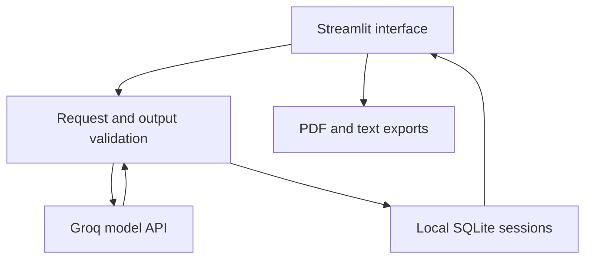

# Interview Studio - Project Report

## Problem

Generic interview question lists rarely align precisely with a job description or define observable scoring criteria. Candidates also need specific feedback on answers, beyond a generic model-generated rating.

## Objectives

Generate role-relevant questions, produce explicit rubrics, support repeated practice, preserve work between sessions and export usable reports. Keep keys out of the interface and saved data.

## Scope

A single-user local Python application. Inputs include role, level, skills, JD, question type and difficulty. Outputs include questions, follow-ups, expected-answer evidence, rubric anchors and optional practice feedback. It assists human preparation and assessment; it does not validate hiring suitability.

## Architecture

## Generation

Pydantic defines explicit input and response contracts. Strict JSON-schema output constrains structure. Additional checks enforce question count, requested type/difficulty mix, two follow-ups, three criteria and a total of ten points. Question history is passed into append requests, and lexical similarity checks reject exact or close repeats. A rejected batch does not partially modify saved work.

## Answer feedback

The model scores each criterion with supporting answer excerpts, explanations, missing points and practice steps. Local checks enforce one score per criterion, valid score ranges, and quotes that occur verbatim in the answer. Positive scores require an evidence quote. Exact quotation is a traceability measure; it does not prove the quoted evidence warrants the score.

## Persistence and state

Parameterized SQLite stores a whitelisted JSON session payload. Keys are not part of that payload. New sessions, appended batches, saved answers and feedback are committed after validation. Failed calls preserve earlier saved data. Editing an answer invalidates its saved feedback after saving; stale feedback is hidden while edits are unsaved.

## Reporting

PDF exports use ReportLab with escaped user text, wrapped paragraphs, page numbering and a bundled Unicode font. Users choose whether to include guides and saved practice data. JSON is a complete portable record; Markdown is a readable interviewer guide. The included sample PDF is a handcrafted demonstration.

## Design decisions

SQLite is adequate for local persistence and avoids operating a separate database server. Streamlit reduces UI setup for a Python project. An agent framework or RAG pipeline would add complexity without a source corpus or a tool-planning requirement. Batch sizes are small to reduce output length and free-tier pressure. Maximum session length is thirty questions to bound history growth.

## Validation and results

See EVALUATION_REPORT.md. Automated checks cover engineering behavior. Live model relevance, correctness and rubric quality require a separate reviewed evaluation; no quality percentage is claimed here.

## Future work

Authentication and per-user ownership before hosting; semantic duplicate detection; calibrated reviewer comparisons; accessible timed practice; configurable retention and encrypted storage. These items are future work, not completed features.

## Portable sessions and focused revisions

JSON backups can be restored as a new session after structural and semantic validation. A new identifier prevents overwriting an existing interview. Unknown top-level fields are discarded. A question can be regenerated at the same type and difficulty; other questions and practice records are retained. Search filters the displayed questions without changing exports.
